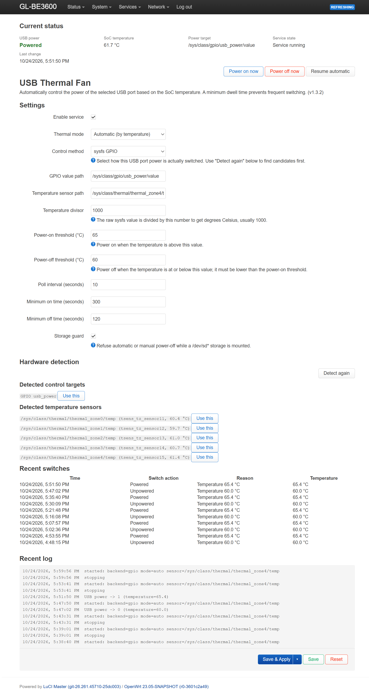

# luci-app-usbpower-temperature

**English** | [简体中文](./README_zh.md)

A LuCI application that switches a USB port's VBUS based on the SoC temperature. It is designed for control the USB fan or any other device without a data connection based on CPU temperature. 

~~FYI, DO NOT place eggs on your router, otherwise you will get cute little chicks!~~ 

Default policy: **power on above 65 °C, power off at or below 60 °C**. The 5 °C hysteresis, a minimum on-time of 300 s and a minimum off-time of 120 s prevent rapid switching.




## English

### Features

- Automatic, always-on and always-off modes
- Four switch backends: sysfs GPIO, `uhubctl`, regulator sysfs and custom commands
- Hardware detection for GPIOs, regulators, uhubctl hubs and thermal sensors
- LuCI status card with 5-second polling and manual power-on/off buttons
- USB power state is shown first and color-coded (Powered/Unpowered); the thermal mode stays in the settings form
- Last 10 switching events in the UI (time, action, reason and temperature; stored in `/tmp/usbpowerd.history` and cleared on reboot)
- On-page recent log with the last 200 daemon log lines (`/tmp/usbpowerd.log`, cleared on reboot); the daemon appends a heartbeat line every 2 minutes, also while the page is closed
- Storage guard: refuses to cut power while a `/dev/sd*` storage is mounted
- Sensor fail-safe: in automatic mode, forces power on after repeated read failures
- English and Simplified Chinese UI, following the LuCI language setting
- Standard UCI configuration, procd service, ipk building and an OpenWrt SDK Makefile

### USB port lifetime

The plugin only switches the board's VBUS power switch; it never touches the connector, so mechanical mating cycles are not consumed. The switch is a solid-state device that the vendor firmware itself uses for USB power-on and reset. The real stress factors are inrush current and fan start/stop cycles, which the default hysteresis and minimum dwell times keep low. Once the fan brings the SoC to a stable temperature above the power-off threshold (for example 62 °C), it keeps running instead of cycling; this is the intended hysteresis behavior.

### Compatibility

- Tested on OpenWrt 23.05 ARM devices with a sysfs GPIO controlling USB VBUS.
- Other devices can use any of the four backends; the `uhubctl` backend requires a hub with per-port power switching.
- One instance controls one target port.

### Dependencies

Runtime:

- `luci-base` — JS modules, the `cbi.js` gettext helper, the translations endpoint and the `admin/system` menu parent. On the tested firmware it hard-depends on `rpcd`, `rpcd-mod-file`, `rpcd-mod-luci`, `rpcd-mod-ucode`, `cgi-io` and `ucode`, so `fs.exec` works without extra packages.
- OpenWrt base system: BusyBox (`sh`, `awk`, `sed`, `mount`, `logger`), `procd` and `uci`.
- No `luci-compat`, `luci-mod-system` or `luci-i18n-*` package is required; the app ships its own `.lmo` catalog.
- Optional: `uhubctl`, only for the uhubctl backend (`opkg install uhubctl`).

Build:

- Python 3.8+ for `tools/build_ipk.py` and `tools/build_lmo.py`.
- No OpenWrt SDK or `msgfmt` is needed for the prebuilt ipk; the SDK is only for the Makefile path.
- `tar` plus PowerShell (or an equivalent transfer) for `install.ps1`.

### Installation

#### From the prebuilt ipk

```sh
python3 tools/build_ipk.py

ROUTER='root@<router>'
scp dist/luci-app-usbpower-temperature_1.3.3-1_all.ipk "$ROUTER:/tmp/"
ssh "$ROUTER" 'opkg install /tmp/luci-app-usbpower-temperature_1.3.3-1_all.ipk'
```

If the router does not have `openssh-sftp-server`, a modern `scp` may fail. Use the stream transfer instead:

```sh
ROUTER='root@<router>'
ssh "$ROUTER" 'cat > /tmp/luci-app-usbpower-temperature.ipk' < dist/luci-app-usbpower-temperature_1.3.3-1_all.ipk
ssh "$ROUTER" 'opkg install /tmp/luci-app-usbpower-temperature.ipk'
```

The LuCI page is available at:

```
http://<router>/cgi-bin/luci/admin/system/usbpower-temperature
```

or through **System → USB Thermal Fan**.

After an upgrade, reload the page. The view asset is versioned to avoid stale browser caches; if the layout still looks old, close and reopen the tab.

The controller runs as a procd service and is independent of the LuCI page. Closing the tab does not stop temperature control. Normal log entries are event-driven (start, stop, switch, storage guard, sensor errors), so the daemon also writes a `heartbeat:` line to `/tmp/usbpowerd.log` every 2 minutes; this line is written to the log file only, not to syslog, so the recent log keeps moving even when the temperature is stable.

#### Development install (Windows PowerShell)

```powershell
$Router = 'root@<router>'
.\install.ps1 -Router $Router
.\install.ps1 -Router $Router -Uninstall -KeepConfig  # uninstall, keep UCI config
.\install.ps1 -Router $Router -Uninstall              # uninstall, remove UCI config
```

Do not mix direct installs with `opkg`. If the files were removed by the direct installer while opkg still thinks the package is installed, restore them with:

```sh
opkg install --force-reinstall /tmp/luci-app-usbpower-temperature_1.3.3-1_all.ipk
```

### Configuration

UCI file: `/etc/config/usbpower_temperature`

| Option | Default | Description |
|---|---|---|
| `enabled` | `0` | Start the daemon; enable it on the LuCI page after installation |
| `mode` | `auto` | `auto`, `always_on` or `always_off` |
| `backend` | `gpio` | `gpio`, `uhubctl`, `regulator` or `command` |
| `gpio_path` | empty | For example `/sys/class/gpio/usb_power/value` |
| `uhubctl_location` | empty | `uhubctl -l` location, for example `1-1` |
| `uhubctl_port` | `1` | `uhubctl -p` port number |
| `regulator_path` | empty | For example `/sys/class/regulator/regulator.0/state` |
| `command_on` / `command_off` | empty | Commands for the custom backend |
| `command_state` | empty | Optional command that prints `1` or `0` |
| `sensor` | `/sys/class/thermal/thermal_zone0/temp` | Temperature source |
| `sensor_divisor` | `1000` | Raw value divisor for Celsius |
| `on_threshold` | `65` | Power on above this temperature |
| `off_threshold` | `60` | Power off at or below this temperature; must be lower |
| `poll_interval` | `10` | Polling interval in seconds, minimum 2 |
| `min_on_time` | `300` | Minimum time to stay powered in seconds |
| `min_off_time` | `120` | Minimum time to stay off in seconds |
| `storage_guard` | `1` | Block power-off while `/dev/sd*` is mounted |

After changing UCI from the command line, restart the service (the LuCI page does this automatically):

```sh
uci commit usbpower_temperature
/etc/init.d/usbpower_temperature restart
```

### Finding the port's power switch

The **Hardware detection** section on the LuCI page lists candidates. On the router you can also run:

```sh
/usr/sbin/usbpowerd detect
```

It returns JSON with:

- `targets`: writable sysfs GPIOs, USB/VBUS-related regulators and compatible `uhubctl` hub ports
- `sensors`: `/sys/class/thermal/thermal_zone*` paths and their temperatures

Typical checks:

- GPIO: `ls /sys/class/gpio`, `cat /sys/kernel/debug/gpio`
- `uhubctl`: run `uhubctl`; only compatible hubs are listed
- Regulator: `grep -i -E 'usb|vbus' /sys/class/regulator/*/name`
- Vendor scripts or `gpioset`: use the `command` backend

### Language and localization

The UI follows the LuCI language (`luci.main.lang`). English strings are the source; Simplified Chinese comes from the bundled catalog. Change the language under **System → System → Language** (or with `uci set luci.main.lang=en` / `zh_cn`).

- Source catalog: `po/zh_Hans/luci-app-usbpower-temperature.po`
- Compiled catalog: `root/usr/lib/lua/luci/i18n/luci-app-usbpower-temperature.zh-cn.lmo`
- Regenerate after changing translatable strings:

```sh
python3 tools/build_lmo.py
python3 tools/build_lmo.py --check
```

The ipk builder refuses to package a stale catalog.

### Safety

- **Storage guard**: before cutting power, a mounted `/dev/sd*` storage blocks the operation and a log entry is written. Set `storage_guard=0` only if you are sure it is safe.
- **Sensor failure**: in `auto` mode, three consecutive read failures force power on. `always_off` is not overridden by sensor failures.
- **Stopping the service** does not change the current GPIO state. After a reboot the vendor firmware powers the port first, then the plugin takes over.
- The internal PWM fan (`pwm-fan`/`glfan`) is never touched.
- There is no fan tachometer input, so the controller is open-loop and cannot detect a stalled fan.
- If the temperature stays above `off_threshold`, the fan runs continuously. To make it stop, raise `off_threshold` above the stable temperature (for example 63–64 °C) and increase `min_on_time`; this increases switching.

### Build

```sh
python3 tools/build_ipk.py
```

Output:

```
dist/luci-app-usbpower-temperature_1.3.3-1_all.ipk
```

On Windows:

```powershell
.\build-ipk.ps1
```

The generated ipk is a gzip-compressed tar package accepted by the opkg versions used by the tested firmware.

To build through the OpenWrt SDK instead, place this directory in `feeds/luci/applications/` and run:

```sh
make package/luci-app-usbpower-temperature/compile V=s
```

The `Makefile` uses `$(TOPDIR)/feeds/luci/luci.mk`, depends on `luci-base` and builds an `all` architecture package.

### Uninstall

```sh
ROUTER='root@<router>'
ssh "$ROUTER" 'opkg remove luci-app-usbpower-temperature'
ssh "$ROUTER" 'rm -f /etc/config/usbpower_temperature'   # remove the configuration too
```

opkg keeps modified configuration files on upgrade/removal and may leave a `*-opkg` default copy; remove it if desired.

### Repository layout

| Path | Purpose |
|---|---|
| `root/` | Files installed on the router (UCI, procd, daemon, LuCI menu/ACL/view, translations) |
| `po/zh_Hans/` | Simplified Chinese translation source |
| `tools/build_lmo.py` | Compiles the `.po` catalog into LuCI `.lmo` |
| `tools/build_ipk.py` | Builds the ipk without the OpenWrt SDK |
| `tools/usb-fan.ps1` | Manual sysfs GPIO helper (gpio backend only) |
| `packaging/` | ipk maintainer scripts |
| `install.ps1` | Development install/uninstall |
| `build-ipk.ps1` | Windows build entry point |
| `Makefile` | OpenWrt SDK entry point |

### Limitations

- One target port per instance.
- Open-loop control without fan feedback.
- `uhubctl` output formats vary; an unparsable status is reported as `unknown` instead of switching blindly.
- Cross-vendor support depends on correct backend configuration; only sysfs GPIO was tested on real hardware.

### License

MIT, see [LICENSE](LICENSE).
