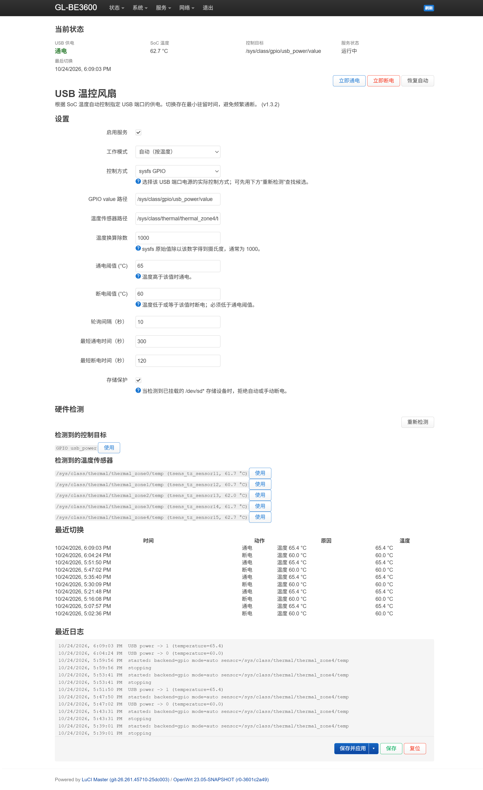

# luci-app-usbpower-temperature

## 简体中文

[**English**](./README.md) | 简体中文

一个基于 SoC 温度控制 USB 端口供电的 LuCI 插件，适合温控路由器 USB 风扇或其他无数据连接的设备。

默认策略：**温度高于 65 °C 给 USB 口通电，低于等于 60 °C 断电**。5 °C 回差、通电至少 300 秒、断电至少 120 秒，避免频繁通断。





### 特性

- 自动、强制通电、强制断电三种模式
- 4 种控制后端：sysfs GPIO、`uhubctl`、regulator sysfs、自定义命令
- 自动检测 GPIO、regulator、`uhubctl` 端口和温度传感器
- LuCI 状态卡片、5 秒轮询、手动通断电按钮
- 当前状态最前面显示 USB 是否通电（通电/断电并带颜色），工作模式只保留在设置表单里
- UI 显示最近 10 条切换记录（时间、动作、原因、温度；存于 `/tmp/usbpowerd.history`，重启清空）
- UI 显示最近 50 行守护进程日志（`/tmp/usbpowerd.log`，重启清空）
- 存储保护：`/dev/sd*` 已挂载时拒绝断电
- 传感器故障保护：自动模式下连续读取失败会强制通电
- 英文/简体中文界面，跟随 LuCI 语言设置
- 标准 UCI 配置、procd 服务、支持 ipk 构建和 OpenWrt SDK Makefile

### USB 接口寿命

插件只切换板载 VBUS 电源开关，不碰连接器，**机械插拔寿命消耗为零**。该开关是固态器件，固件本身也用它做 USB 上电和复位。真正的应力来自上电浪涌和风扇启停，默认回差和最小驻留时间已经把切换次数压得很低。如果风扇把 SoC 稳定在断电阈值之上（例如 62 °C），它就会持续运行而不是反复启停，这是回差设计的正常结果。

### 兼容性

- 已在通过 sysfs GPIO 控制 USB VBUS 的 OpenWrt 23.05 ARM 设备上验证。
- 其他设备可选择四种后端之一；`uhubctl` 后端要求 Hub 支持 per-port 电源切换。
- 一个实例只控制一个目标端口。

### 依赖

运行时：

- `luci-base` —— 提供 JS 模块、`cbi.js` 翻译助手、翻译接口和 `admin/system` 菜单父节点。在已验证固件上它硬依赖 `rpcd`、`rpcd-mod-file`、`rpcd-mod-luci`、`rpcd-mod-ucode`、`cgi-io` 和 `ucode`，因此 `fs.exec` 无需额外包。
- OpenWrt 基础系统：BusyBox（`sh`、`awk`、`sed`、`mount`、`logger`）、`procd` 和 `uci`。
- 不需要 `luci-compat`、`luci-mod-system` 或 `luci-i18n-*`；插件自带 `.lmo` 翻译目录。
- 可选：`uhubctl`，仅使用 uhubctl 后端时安装（`opkg install uhubctl`）。

构建：

- Python 3.8+，用于 `tools/build_ipk.py` 和 `tools/build_lmo.py`。
- 预构建 ipk 不需要 OpenWrt SDK 或 `msgfmt`；SDK 只用于 Makefile 构建路径。
- `install.ps1` 需要 `tar` 和 PowerShell（或等价的传输方式）。

### 安装

#### 使用预构建 ipk

```sh
python3 tools/build_ipk.py

ROUTER='root@<router>'
scp dist/luci-app-usbpower-temperature_1.3.2-1_all.ipk "$ROUTER:/tmp/"
ssh "$ROUTER" 'opkg install /tmp/luci-app-usbpower-temperature_1.3.2-1_all.ipk'
```

若路由器没有 `openssh-sftp-server`，新版 `scp` 可能报错，可改用：

```sh
ROUTER='root@<router>'
ssh "$ROUTER" 'cat > /tmp/luci-app-usbpower-temperature.ipk' < dist/luci-app-usbpower-temperature_1.3.2-1_all.ipk
ssh "$ROUTER" 'opkg install /tmp/luci-app-usbpower-temperature.ipk'
```

LuCI 页面地址：

```
http://<router>/cgi-bin/luci/admin/system/usbpower-temperature
```

也可以在 **System → USB 温控风扇** 打开。

升级后请刷新页面。视图文件名带版本号，用于避开浏览器缓存；如果布局看起来还是旧的，请关闭标签页后重新打开。

#### 开发期直装（Windows PowerShell）

```powershell
$Router = 'root@<router>'
.\install.ps1 -Router $Router
.\install.ps1 -Router $Router -Uninstall -KeepConfig  # 卸载，保留 UCI 配置
.\install.ps1 -Router $Router -Uninstall              # 卸载并删除 UCI 配置
```

不要混用直装和 `opkg`。如果直装脚本删掉了文件但 opkg 仍认为已安装，可用 `opkg install --force-reinstall` 恢复。

### 配置

UCI 文件：`/etc/config/usbpower_temperature`

| 选项 | 默认值 | 说明 |
|---|---|---|
| `enabled` | `0` | 是否启动守护进程；安装后在 LuCI 页面启用 |
| `mode` | `auto` | `auto`、`always_on`、`always_off` |
| `backend` | `gpio` | `gpio`、`uhubctl`、`regulator`、`command` |
| `gpio_path` | 空 | 例如 `/sys/class/gpio/usb_power/value` |
| `uhubctl_location` | 空 | `uhubctl -l` 位置，例如 `1-1` |
| `uhubctl_port` | `1` | `uhubctl -p` 端口号 |
| `regulator_path` | 空 | 例如 `/sys/class/regulator/regulator.0/state` |
| `command_on` / `command_off` | 空 | 自定义命令后端的通/断命令 |
| `command_state` | 空 | 可选，输出 `1` 或 `0` 表示状态 |
| `sensor` | `/sys/class/thermal/thermal_zone0/temp` | 温度源 |
| `sensor_divisor` | `1000` | 原始值换算为摄氏度的除数 |
| `on_threshold` | `65` | 高于该温度通电 |
| `off_threshold` | `60` | 低于等于该温度断电，必须小于通电阈值 |
| `poll_interval` | `10` | 轮询秒数，最小 2 |
| `min_on_time` | `300` | 通电后的最短保持秒数 |
| `min_off_time` | `120` | 断电后的最短保持秒数 |
| `storage_guard` | `1` | 有 `/dev/sd*` 挂载时禁止断电 |

通过命令行修改 UCI 后需要重启服务（LuCI 页面保存时会自动重启）：

```sh
uci commit usbpower_temperature
/etc/init.d/usbpower_temperature restart
```

### 找到端口的电源开关

页面上的 **硬件检测** 会列出候选；也可以在路由器上运行：

```sh
/usr/sbin/usbpowerd detect
```

返回 JSON：

- `targets`：可写 sysfs GPIO、名字含 usb/vbus 的 regulator、`uhubctl` 检测到的兼容 Hub 端口
- `sensors`：`/sys/class/thermal/thermal_zone*` 路径及温度

常用排查方式：

- GPIO：`ls /sys/class/gpio`、`cat /sys/kernel/debug/gpio`
- `uhubctl`：直接运行 `uhubctl`，能列出的才是支持电源切换的 Hub
- regulator：`grep -i -E 'usb|vbus' /sys/class/regulator/*/name`
- 厂商私有脚本或 `gpioset`：使用 `command` 后端

### 语言与本地化

界面跟随 LuCI 语言（`luci.main.lang`）。英文是源字符串，简体中文来自随包安装的翻译目录。可在 **System → System → Language** 切换语言（或 `uci set luci.main.lang=en` / `zh_cn`）。

- 翻译源文件：`po/zh_Hans/luci-app-usbpower-temperature.po`
- 编译后的目录：`root/usr/lib/lua/luci/i18n/luci-app-usbpower-temperature.zh-cn.lmo`
- 修改界面文案后重新生成并校验：

```sh
python3 tools/build_lmo.py
python3 tools/build_lmo.py --check
```

如果目录未更新，ipk 构建会直接报错。

### 安全说明

- **存储保护**：断电前如果检测到 `/dev/sd*` 已挂载，会拒绝操作并记录日志。确认安全后再把 `storage_guard` 设为 `0`。
- **传感器故障**：`auto` 模式连续 3 次读取失败会强制通电；`always_off` 不会被传感器故障改回通电。
- **停止服务**不会改变 GPIO 当前状态；重启后先由固件默认逻辑上电，再由插件接管。
- 不会修改内部 PWM 风扇（`pwm-fan`/`glfan`）的任何配置。
- 风扇没有转速反馈，本插件是开环温控，无法判断堵转。
- 如果风扇开启后温度始终高于断电阈值，风扇会持续运行。想让它停下，可把断电阈值调到稳定温度之上（如 63–64 °C），并适当增大 `min_on_time`，代价是通断次数增加。

### 构建

```sh
python3 tools/build_ipk.py
```

产物：

```
dist/luci-app-usbpower-temperature_1.3.2-1_all.ipk
```

Windows 下：

```powershell
.\build-ipk.ps1
```

生成的 ipk 是 gzip 压缩 tar 格式，适配已验证固件的 opkg。

使用 OpenWrt SDK 正式构建时，把目录放入 `feeds/luci/applications/` 后执行：

```sh
make package/luci-app-usbpower-temperature/compile V=s
```

`Makefile` 使用 `$(TOPDIR)/feeds/luci/luci.mk`，依赖 `luci-base`，包架构为 `all`。

### 卸载

```sh
ROUTER='root@<router>'
ssh "$ROUTER" 'opkg remove luci-app-usbpower-temperature'
ssh "$ROUTER" 'rm -f /etc/config/usbpower_temperature'   # 如需连同配置删除
```

opkg 会保留被修改过的配置文件，并可能留下带 `-opkg` 后缀的新默认文件，按需删除。

### 目录结构

| 路径 | 作用 |
|---|---|
| `root/` | 安装到路由器的文件（UCI、procd、守护进程、LuCI 菜单/ACL/视图、翻译目录） |
| `po/zh_Hans/` | 简体中文翻译源文件 |
| `tools/build_lmo.py` | 把 `.po` 编译成 LuCI `.lmo` |
| `tools/build_ipk.py` | 无需 OpenWrt SDK 的 ipk 构建脚本 |
| `tools/usb-fan.ps1` | 手动 sysfs GPIO 控制示例（仅 gpio 后端） |
| `packaging/` | ipk 维护脚本 |
| `install.ps1` | 开发期直装/卸载 |
| `build-ipk.ps1` | Windows 构建入口 |
| `Makefile` | OpenWrt SDK 构建入口 |

### 限制

- 单实例只控制一个端口。
- 开环控制，无风扇反馈。
- `uhubctl` 不同版本输出格式可能不同；解析失败会显示 `unknown`，不会盲目切换。
- 跨厂商兼容性取决于后端配置是否正确；目前只在 sysfs GPIO 真机上验证。

### 许可证

MIT，见 [LICENSE](LICENSE)。
